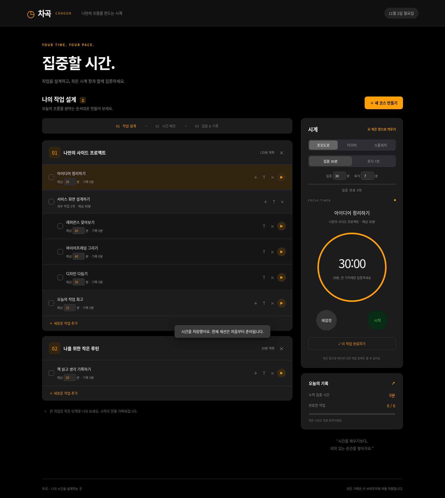
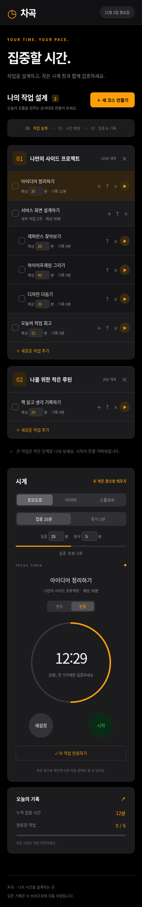
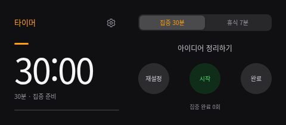
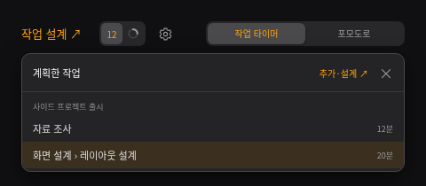
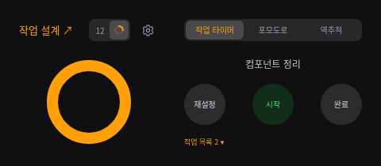

# 차곡 · CHAGOK

작업을 순서대로 설계하고 예상 시간과 실제 집중 시간을 기록하는 한국어 웹 앱입니다.

## 화면 미리보기



<details>
<summary>모바일 화면 보기</summary>



</details>

## Windows에서 바로 실행

[Windows EXE 다운로드 페이지](https://github.com/jeongseul1116/new_time/releases/latest)에서 **Chagok-1.1.1-Windows.exe**를 다운로드하고 더블클릭하세요. Node.js나 터미널이 필요 없는 Windows 10/11 64비트용 포터블 앱입니다. 업데이트할 때는 기존 차곡 앱을 완전히 종료한 뒤 새 EXE를 실행하세요. 저장된 작업과 기록은 유지됩니다.

- 실행하면 480×210 작은 시계 창이 열리고 항상 위에 표시됩니다. 저장된 작업이 없으면 작업 설계 화면도 함께 열립니다.
- 작은 창 왼쪽의 **작업 설계 ↗**를 누르면 코스와 작업을 만들고 세부 작업·예상 시간을 입력할 수 있습니다. **작업 목록**에서 실행할 작업을 선택하면 해당 예상 시간으로 타이머가 시작됩니다. 포모도로는 별도 모드로 선택합니다.
- 집중·휴식 시간과 기록은 PC의 앱 데이터에 자동 저장됩니다.
- 처음 실행할 때는 GitHub EXE의 압축 해제와 초기화에 잠시 시간이 걸릴 수 있습니다.

## 웹 개발 모드 실행

Node.js 24에서 외부 패키지 설치 없이 실행합니다.

```sh
npm start
```

기본 포트는 3000이며 `PORT` 환경 변수로 변경할 수 있습니다.

- 코스와 작업, 세부 작업 추가 및 삭제
- 예상 시간 지정, 작업 순서 변경, 완료 처리
- 시작·일시 정지·초기화 및 누적 집중 시간
- 브라우저 localStorage 자동 저장, 새로고침 후 타이머 복원

데이터는 현재 브라우저에 보관됩니다. 서버 동기화나 계정 기능은 포함하지 않습니다. 타이머는 예상 시간에서 거꾸로 세고, 시간이 끝나면 멈춥니다. 스톱워치는 실제 경과 시간을 측정합니다.

## 작은 창으로 사용하기

오른쪽 시계의 **작은 창으로 띄우기** 버튼을 누르세요. 데스크톱 Chrome·Edge의 Document Picture-in-Picture 지원 환경(HTTPS 또는 localhost)에서는 다른 창 위에 고정되는 창으로 열립니다. 브라우저가 지원하지 않으면 일반 별도 팝업으로 열리며, 이 경우 항상 위 고정은 제공하지 않습니다. 팝업 차단 시 해당 사이트의 팝업을 허용해 주세요. 원래 앱 탭을 닫으면 작은 창의 작동도 종료됩니다.



**작업 목록**을 누르면 계획한 작업과 예상 시간을 확인하고 실행할 작업을 고를 수 있습니다. 편집은 **작업 설계 ↗**에서 진행합니다.



## 포모도로

기본 집중 25분·휴식 5분으로 시작합니다. 본 화면과 작은 창에서 각각 1~180분으로 설정할 수 있으며 브라우저에 자동 저장됩니다. 현재 단계의 시간을 바꾸면 측정을 멈추고 해당 세션을 초기화하며, 누적 작업 시간은 유지합니다. 집중 종료 시 완료 횟수를 기록하고 휴식 준비로 전환합니다. 다음 단계는 시작 버튼을 눌러 진행합니다. 휴식은 작업 집중 시간에 포함되지 않습니다.

작은 시계 창은 480×210 크기의 가로형 레이아웃입니다. 왼쪽에 시간과 진행률, 오른쪽에 작업명과 원형 조작 버튼을 배치했습니다. 왼쪽 제목 옆 설정 아이콘에서 집중·휴식 시간을 변경합니다. 재설정·시작·완료는 같은 크기의 원형 버튼으로, 동일한 간격을 두고 배치했습니다.

## 숫자 / 원형 보기

본 화면의 **숫자·원형** 버튼이나 작은 창 제목 옆 보기 아이콘으로 전환합니다. 숫자 보기는 남은 시간을 크게 표시하고, 원형 보기는 가운데를 비운 두꺼운 주황색 링이 남은 시간에 비례해 줄어듭니다. 원형 보기에서는 숫자 시간과 설명을 숨기고 끝이 둥근 주황색 링만 표시합니다.

보기 변경은 실행·일시 정지 상태와 남은 시간에 영향을 주지 않으며 자동 저장됩니다. 포모도로 집중·휴식과 일반 타이머에서 사용할 수 있습니다. 종료 시간이 정해져 있지 않은 스톱워치는 숫자로 표시합니다.



## 데스크톱 개발 및 EXE 빌드

```sh
npm ci
npm run desktop
npm run dist:win
```

`release/Chagok-1.1.1-Windows.exe`에 포터블 실행 파일을 생성합니다. 앱 소스는 Electron의 격리된 렌더러에서 실행하며 런타임을 함께 패키징합니다. GitHub Actions의 **Build Windows EXE** 워크플로가 Windows에서 빌드하고 Windows Defender 검사와 빌드 출처 증명을 완료한 뒤 버전별 릴리스에 EXE를 올립니다. 이미 게시한 버전의 파일은 덮어쓰지 않습니다.

현재 EXE는 코드 서명 인증서가 없는 빌드입니다. Windows에서 게시자 확인 경고가 표시될 수 있습니다.

## 다운로드 검증

공식 [릴리스 페이지](https://github.com/jeongseul1116/new_time/releases/latest)에는 EXE와 다음 검증 자료를 함께 게시합니다.

- `Defender-scan.json`: 실제 Microsoft Defender 검사 결과, 엔진·탐지 서명 버전, 검사 시각과 빌드 링크
- `SHA256SUMS.txt`: EXE와 검사 보고서의 SHA-256 해시
- `build-provenance.jsonl`: 해당 EXE의 GitHub Actions 빌드 출처 증명

검사 불가, 탐지, 체크섬 불일치 또는 출처 증명 실패 시 새 릴리스는 게시하지 않습니다. 검사에서 탐지되지 않았다는 결과는 완전한 안전성을 보장하지 않습니다. 현재 앱은 게시자 코드 서명이 없으므로 SmartScreen 경고가 표시될 수 있습니다. 해시와 빌드 출처 증명은 게시자 서명을 대신하지 않습니다.

Windows PowerShell에서 다운로드한 파일의 해시를 확인할 수 있습니다. 출력된 값을 공식 릴리스의 `SHA256SUMS.txt`에 적힌 값과 비교하세요.

```powershell
Get-FileHash .\Chagok-1.1.1-Windows.exe -Algorithm SHA256
```

GitHub CLI를 사용하는 경우 빌드 출처도 확인할 수 있습니다.

```sh
gh attestation verify Chagok-1.1.1-Windows.exe --repo jeongseul1116/new_time
```
